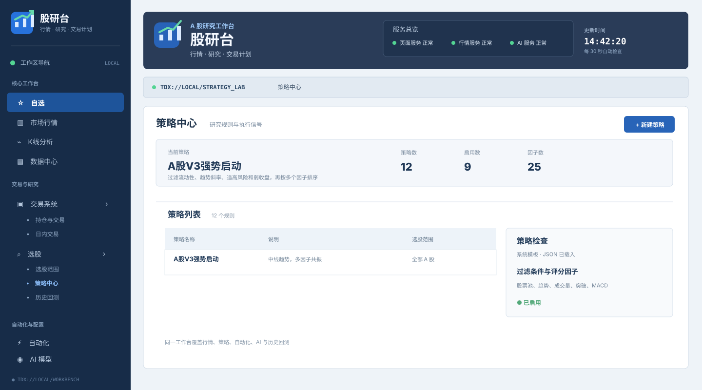
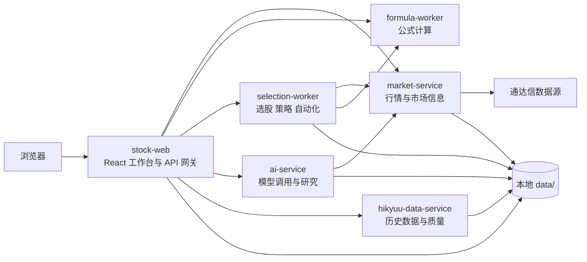

# 股研台

股研台（Guyantai）是一个本地运行的 A 股行情与研究工作台，面向个人研究、策略验证、盘后复盘和交易计划管理。

它把行情、K 线、公式、选股、策略、历史回测、自动化、AI 研究和交易记录放在同一个工作台中。项目不提供投资建议，也不承诺策略收益；数据质量和结果应由使用者自行复核。

当前版本：`0.1.3`

<p align="center">
  
</p>

## 功能概览

| 模块 | 能做什么 |
| --- | --- |
| 自选与行情 | 查看实时行情、盘口、分时和多周期 K 线 |
| K 线分析 | 查看指标、叠加公式并结合结构化数据研究个股 |
| 数据中心 | 查询股票目录、财务、板块、股本、交易日历和历史数据 |
| 公式中心 | 管理选股公式和图表指标，支持 HQChartPy2 与 fallback 执行器 |
| 选股与策略 | 配置股票池、过滤因子、评分因子和策略运行参数 |
| 历史回测 | 按交易日回放策略信号，模拟 A 股撮合、持仓和交易流水 |
| 自动化 | 通过 Cron 运行公式、策略、数据同步和结果跟踪任务 |
| 每日复盘 | 查看信号、前向表现、达标率、MFE/MAE 和执行模拟 |
| AI 研究 | 对单股、自选列表和候选股票进行结构化分析与解释 |
| 交易系统 | 记录交易卡、仓位、退出规则、复盘和日内交易信号 |
| 宏观预警 | 同步 CPI、非农、FOMC、PCE 等事件并生成风险窗口提醒 |

### 策略模型

策略不是散落在页面里的固定按钮，而是由数据库中的 `config_json` 保存配置：

- 系统模板由代码提供，启动时同步到 SQLite；
- 自定义策略可以在策略中心创建、编辑、复制和运行；
- 过滤条件、评分因子、权重、最低分、入选数量和股票池都可以配置；
- 新增全新的因子计算逻辑时，仍需要在 Go 服务中实现并注册因子；
- 系统模板不能直接改规则，复制后即可作为自定义策略调整。

## 架构



| 服务 | 目录 | 默认端口 | 职责 |
| --- | --- | ---: | --- |
| Web 工作台 | `apps/web/` | `8080` | React 页面、业务 API 和服务代理 |
| 行情服务 | `services/market-service/` | `18081` | 实时行情、K 线、财务、板块和交易日历 |
| 公式 worker | `services/formula-worker/` | `18712` | HQChartPy2 或内置 fallback 公式执行 |
| 选股 worker | `services/selection-worker/` | `18082` | 股票池、公式选股、策略、回测和自动化 |
| AI 服务 | `services/ai-service/` | `18083` | 模型配置、聊天、单股和候选集分析 |
| Hikyuu 数据服务 | `services/hikyuu-data-service/` | `18091` | 历史数据同步、质量检查和参考指标 |

共享代码位于：

```text
packages/tdx-core/        # 通达信协议、数据模型和基础拉取逻辑
packages/workbench-core/  # SQLite 存储、公式、策略和任务模型
packages/quote-protocol/  # 通达信 TCP 协议客户端
```

## 快速开始

### Docker Compose（推荐）

要求：

- Docker Desktop 或 Docker Engine
- Docker Compose v2

在项目根目录执行：

```bash
docker compose up -d --build
```

打开：<http://localhost:8080>

检查服务：

```bash
docker compose ps
curl http://localhost:8080/api/health
curl http://localhost:8080/api/services/status
```

第一次使用 AI 时，在 `AI 模型` 工作区配置并启用一个 provider。不配置 AI 也可以使用行情、数据、公式、选股、策略和回测功能。

常用维护命令：

```bash
docker compose logs -f stock-web
docker compose logs -f selection-worker
docker compose up -d --build stock-web
docker compose restart market-service
docker compose down
```

### 数据目录

Compose 会把 `./data` 挂载到容器。SQLite、行情缓存、Hikyuu 数据、同步日志和任务结果都会保存在这里。重建镜像不会主动清空数据；删除或迁移前请先备份。

```text
data/
├── database/       # SQLite 与行情数据
├── hikyuu/stocks/  # Hikyuu 历史数据
├── hikyuu/config/  # Hikyuu 配置
└── hikyuu/logs/    # 同步日志
```

## 源码开发

要求：

- Go 1.25+
- Node.js 20.19+ 或 22.12+
- Python 3.11+
- SQLite
- 完整公式能力需要 HQChartPy2 运行环境；没有扩展时可使用 fallback
- 历史数据服务需要 `hikyuu==2.8.2`；本机无法安装时，可通过 Docker Compose 单独运行该服务

先构建前端：

```bash
cd apps/web/frontend
npm ci
npm run build
```

构建结果会写入 `apps/web/static-react/`。Docker 镜像直接提供该目录，因此修改前端源码后需要重新构建并提交静态产物，或在 CI 中完成构建。

先在一个终端安装并启动 Hikyuu 数据服务：

```bash
python3 -m pip install -r services/hikyuu-data-service/requirements.txt
python3 -m pip install hikyuu==2.8.2
(cd services/hikyuu-data-service && uvicorn app:app --host 0.0.0.0 --port 8091)
```

若当前 Python 环境无法安装 Hikyuu，可改用 Docker Compose 启动这个服务。

然后在其他独立终端中依次启动公式、行情和选股服务：

```bash
python3 services/formula-worker/worker.py
```

```bash
cd services/market-service
PORT=8081 HIKYUU_DATA_SERVICE_URL=http://localhost:8091 go run .
```

```bash
cd services/selection-worker
PORT=8082 FORMULA_WORKER_URL=http://localhost:8712 MARKET_SERVICE_URL=http://localhost:8081 AUTOMATION_SCHEDULER_ENABLED=false go run .
```

再启动 AI 服务和 Web 工作台：

```bash
cd services/ai-service
PORT=8083 MARKET_SERVICE_URL=http://localhost:8081 HIKYUU_DATA_SERVICE_URL=http://localhost:8091 go run .
```

```bash
cd apps/web
MARKET_SERVICE_URL=http://localhost:8081 HIKYUU_DATA_SERVICE_URL=http://localhost:8091 FORMULA_WORKER_URL=http://localhost:8712 SELECTION_WORKER_URL=http://localhost:8082 AI_SERVICE_URL=http://localhost:8083 go run .
```

如果 Web 的 `8080` 端口被占用，可给最后一条命令增加 `PORT=18080`。

```bash
cd apps/web
PORT=18080 MARKET_SERVICE_URL=http://localhost:8081 HIKYUU_DATA_SERVICE_URL=http://localhost:8091 FORMULA_WORKER_URL=http://localhost:8712 SELECTION_WORKER_URL=http://localhost:8082 AI_SERVICE_URL=http://localhost:8083 go run .
```

## 配置

Compose 已经提供服务间默认地址。长期运行或部署到共享网络时，建议在 `.env` 或部署环境中显式设置：

| 变量 | 作用 |
| --- | --- |
| `AI_CREDENTIAL_SECRET` | 加密保存 AI 凭据；长期部署必须固定并使用随机值 |
| `AI_SERVICE_TOKEN` | Web 与 AI 服务之间的访问令牌 |
| `DEEPSEEK_API_KEY` | 通过环境变量提供 DeepSeek API Key |
| `DEEPSEEK_BASE_URL` | DeepSeek 或兼容接口地址 |
| `MARKET_SERVICE_URL` | AI/选股服务访问行情服务的地址 |
| `HIKYUU_DATA_SERVICE_URL` | AI 和行情服务访问 Hikyuu 数据服务的地址 |
| `FORMULA_WORKER_URL` | Web/选股服务访问公式 worker 的地址 |
| `SELECTION_WORKER_URL` | Web 访问选股 worker 的地址 |
| `MARKET_SYNC_ON_START` | 行情服务启动时是否同步基础数据 |
| `AUTOMATION_SCHEDULER_ENABLED` | 是否启用自动化调度 |
| `MACRO_EVENT_SYNC_ENABLED` | 是否启用宏观事件自动同步 |
| `MACRO_EVENT_SYNC_INTERVAL` | 宏观事件同步间隔，例如 `12h` |

默认 Compose 配置面向本机试用，包含开发默认值和调试端口。部署到公网或共享网络前，请替换密钥、设置服务令牌，并收紧端口和反向代理策略。

## 数据与功能边界

- 行情可能延迟、缺失或来自回退数据源；页面显示的服务状态不等于数据完整性证明。
- Hikyuu 负责历史数据初始化和增量同步；TDX 负责实时行情，并在历史缺失时作为回退来源。
- 回测使用历史数据和模拟撮合规则，不等于真实成交；涨停、跌停、停牌、滑点、费用和复权都会影响结果。
- AI 输出依赖配置的第三方模型和行情上下文；不会自动替代交易决策。
- API Key 和本地数据库属于敏感运行数据，不要提交到 Git 或公开部署目录。

## 常用 API

```bash
# 服务状态
curl http://localhost:8080/api/services/status

# 实时行情
curl "http://localhost:8080/api/quote?code=000001"

# 历史 K 线
curl "http://localhost:8080/api/kline-history?code=000001&type=day&limit=120"

# 公式服务状态
curl http://localhost:8080/api/formula/health

# 策略列表
curl http://localhost:8080/api/strategies

# 宏观事件
curl "http://localhost:8080/api/macro-events?impact=high"
```

完整参数、响应格式和错误码见 [API 参考](docs/api-reference.md)。

## 开发验证

根目录是多模块 `go.work` 工作区，应该按模块执行测试：

```bash
docker compose config --quiet
node --check apps/web/static/app.js

for module in \
  packages/tdx-core \
  packages/workbench-core \
  apps/web \
  services/market-service \
  services/selection-worker \
  services/ai-service; do
  (cd "$module" && go test ./...)
done

(cd apps/web/frontend && npm ci && npm run build)
```

## 项目结构

```text
tdx-api/
├── apps/web/                    # Web 页面、API 网关和工作台后端
│   └── frontend/                # React + Vite 源码
├── services/
│   ├── market-service/          # 行情服务
│   ├── formula-worker/          # 公式执行服务
│   ├── selection-worker/        # 选股、策略、回测和自动化
│   ├── ai-service/              # AI 模型与分析
│   └── hikyuu-data-service/     # Hikyuu 数据服务
├── packages/
│   ├── tdx-core/                # 通达信核心库
│   ├── quote-protocol/          # 通达信 TCP 协议客户端
│   └── workbench-core/          # 共享模型、SQLite 存储和模板
├── data/                        # 本地运行数据，不应提交
├── docs/                        # 使用、部署、API 和研究文档
├── docker-compose.yml           # 多服务部署入口
└── go.work                      # Go 多模块工作区
```

## 文档

| 文档 | 内容 |
| --- | --- |
| [Web 使用指南](docs/web-guide.md) | 工作区入口和主要操作流程 |
| [部署指南](docs/deployment-guide.md) | Docker、本地运行、验证和排障 |
| [API 参考](docs/api-reference.md) | REST API 参数、响应和示例 |
| [交易系统 V1.1](docs/TRADING_SYSTEM_V1_1.md) | 交易卡、退出规则和 R 统计 |
| [持仓止盈止损与预警](docs/trading-risk-alerts.md) | ATR 与支撑价位、Webhook 开关和每日去重 |
| [历史回测对照分析](docs/HISTORICAL_BACKTEST_CONTROL_GROUP_PLAN.md) | 策略信号和同日对照组设计 |
| [短线策略研究](docs/SHORT_TERM_STRATEGY_RESEARCH.md) | 研究候选策略和验证口径 |
| [复权算法](docs/gbbq-adjustment.md) | 除权除息数据和复权计算 |

## 参与贡献

欢迎提交 Issue、改进文档、修复数据兼容问题或补充测试。提交代码前建议：

1. 说明问题或使用场景，以及数据源和运行环境。
2. 为行为变化补充对应模块的测试。
3. 执行上面的 Go 测试、前端构建和 `docker compose config --quiet`。
4. 不提交 `data/`、API Key、个人配置和构建缓存。

## 许可与第三方组件

当前仓库尚未提供根目录 `LICENSE` 文件。正式公开发布前，请根据项目作者的许可意图补充许可证，并确认以下依赖和目录的许可证兼容性：

- [injoyai/tdx](https://github.com/injoyai/tdx)
- [HQChart](https://github.com/jones2000/HQChart)
- [hqchartPy2](https://github.com/jones2000/hqchartPy2)
- [hikyuu](https://github.com/fasiondog/hikyuu)
- [oficcejo/tdx-api](https://github.com/oficcejo/tdx-api)

第三方代码和资源以其各自仓库中的许可证和声明为准。

## 免责声明

本项目仅用于学习、研究、数据整理和策略验证。项目作者不对行情准确性、数据连续性、策略结果、AI 输出或任何投资决策造成的损失负责。连接第三方模型或数据服务时，请自行确认其隐私、计费和使用条款。
